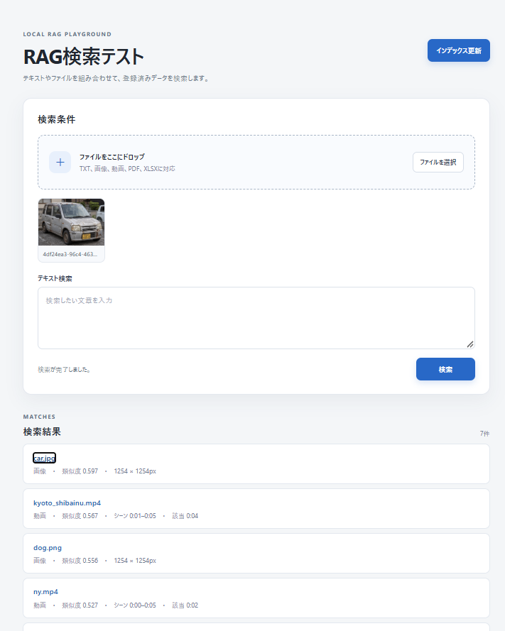
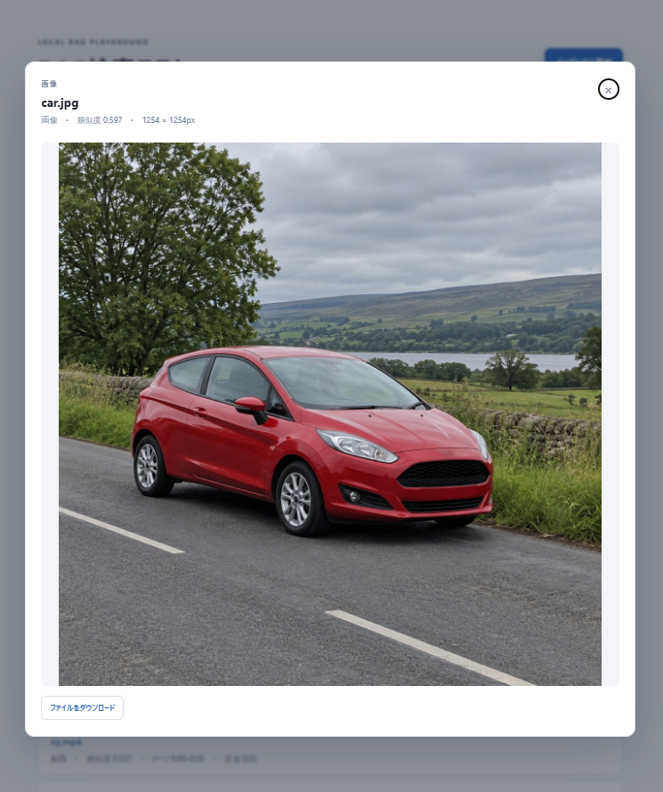
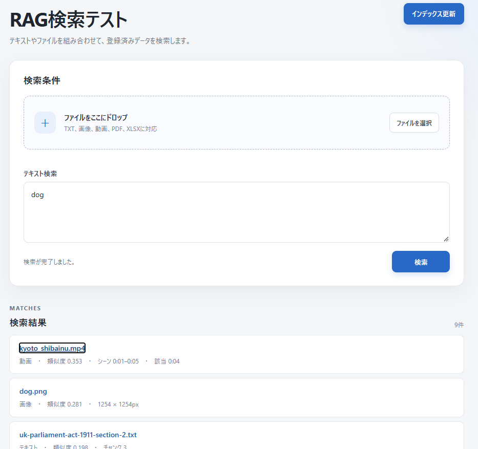
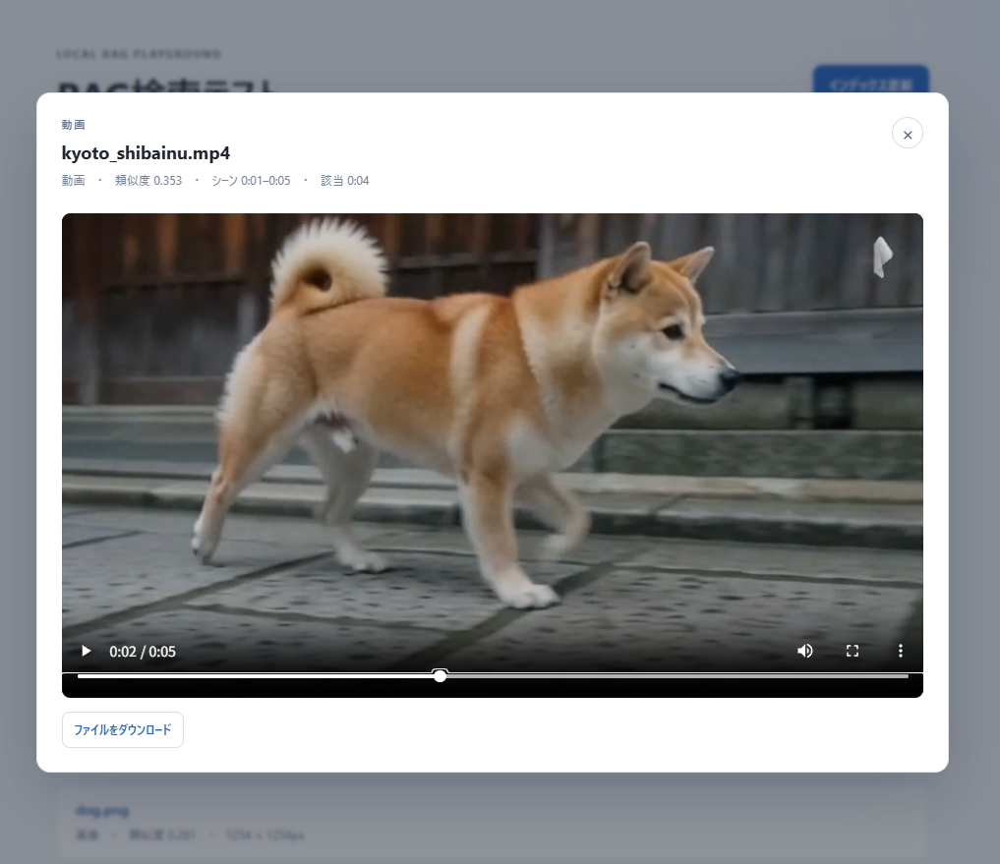

# マルチモーダルRAG検索 PoC Phase 1

## プロジェクトの目的と検証範囲

このプロジェクトでは、Windows 11とNVIDIA GeForce RTX 3070の環境で、テキスト・画像・動画を扱うマルチモーダルRAG検索を検証する。Phase 1の対象はEmbedding生成とベクトル検索で、LLMによる回答生成は扱わない。テキストファイル・画像・動画を登録し、それぞれを検索クエリに使えることを確認した。テキストクエリではテキスト・画像・動画を検索する。画像クエリでは画像・動画、動画クエリでは動画を検索する。

RAG本体はUbuntu上で動き、Windows側ではWSL 2の構築と起動を行う。RAG本体のLinux移植は比較的容易と見込んでいるが、Linux上の動作は未確認である。現状のセットアップはPowerShell、WSLのディストリビューション管理、Windows側のパスに依存する。移植時はセットアップ・起動スクリプトとパス設定を置き換え、GPUと依存関係を確認する必要がある。

### クイックスタート
```powershell
$OutputEncoding = [System.Text.UTF8Encoding]::new($false)
Get-Content .\README.md -Raw -Encoding UTF8 | codex exec -C . "READMEの手順に従って環境をセットアップし、スモークテストと同梱テストデータのインデックス作成まで実行してください。前提条件が不足または確認不能なら、インストールや変更をせず停止して報告してください。"
```

## 技術スタック

### Phase 1で使用中

| 項目 | 技術・構成 |
| --- | --- |
| ホストOS | Windows 11 |
| Linux環境 | 専用WSL 2ディストリビューション `RAG-Ubuntu`（Ubuntu 24.04.5） |
| GPU | NVIDIA GeForce RTX 3070 8GB。Windows側のNVIDIAドライバーを使い、WSLからCUDAを利用する |
| 言語・実行環境 | Python 3.12、WSL内のvenv |
| GPU推論 | PyTorch 2.11.0+cu128、CUDA 12.8 |
| マルチモーダルEmbedding | Jina CLIP v2でテキストと画像・動画フレームを共通のベクトル空間に変換。ベクトル次元数は1024。モデルと補助コードのリビジョンは `model-cache.json` で固定 |
| マルチモーダル検索 | テキストはTXT・画像・動画・PDF、画像とPDFは画像・動画・PDF、動画は動画を検索 |
| AIライブラリ | Sentence Transformers 3.4.1、Transformers 4.48.3 |
| ベクトルDB | Qdrant Server 1.19.1（qdrant-client 1.19.1）。WSL内の127.0.0.1:6333へ接続。1024次元・Cosine・float16で保存 |
| インデックス状態管理 | SQLiteとファイル内容ハッシュ。未変更ファイルの再登録を省き、更新ファイルを判定 |
| テキスト処理 | TXTをチャンク化して登録。チャンク幅1000文字、重複幅100文字 |
| 画像処理 | Pillowによる読み込みと画像Embedding |
| 動画処理 | FFmpegによるフレーム抽出、PySceneDetect 0.7.1によるシーン検出。シーン代表フレームと5秒間隔のフレームを登録 |
| PDF処理 | pypdfium2 5.15.2でページを画像化し、1ページ1ベクトルで登録。画像だけのPDFとZIP内PDFに対応 |
| ZIP処理 | ZIP単位で更新を管理。内部のTXT・画像・動画・PDFを個別に登録し、結果はZIP単位に集約して内部ファイルをプレビュー |
| CLI | `index.py` と `search.py`。検索結果などの標準出力はJSON |
| デモUI | Python標準ライブラリの `HTTPServer` と静的HTML/CSS/JavaScript |
| Codex連携 | Codex CLIからWSL内のPython CLIを実行。MCPとDockerは使用しない |
| キャッシュ・一時データ | モデル、Qdrant、SQLite、動画フレーム、一時ファイルをWSL仮想ディスク内に保存 |

### 今後の導入候補（Phase 1では未使用）

| 用途 | 候補技術 | 状況 |
| --- | --- | --- |
| DOCX処理 | Docling | Phase 2候補。現行の入力対象外 |
| XLSX処理 | openpyxl | Phase 2候補。現行の入力対象外 |
| OCR | RapidOCR、必要に応じてTesseract | Phase 2候補。現行では未実装 |
| 動画音声の文字起こし | faster-whisper | Phase 3候補。現行では未実装 |

## 固定要件

- リポジトリはWSLから参照できるドライブ文字付きのローカルパスに置く。RAGの実行・管理対象（コード、データ、スクリプト、モデル取得キャッシュ、WSL仮想ディスクなど）はすべてリポジトリ内の `rag\` の下に置く。UNCパスは使わない。
- リポジトリルート直下には `README.md` と `LICENSE` を置き、RAGの実装やデータなどは置かない。
- Windows GPUドライバー、Microsoft WSL共有カーネル、ディストリビューションの登録情報はOS管理対象とする。WSL内にLinux版NVIDIAドライバーを入れない。
- Microsoft Store版Ubuntuアプリは追加せず、Ubuntu 24.04.5の専用WSL 2ディストリビューション `RAG-Ubuntu` を `rag\.wsl\RAG-Ubuntu\` に登録する。
- 既存の `Ubuntu` ディストリビューションは変更しない。
- Phase 1ではTXT、JPG/JPEG/PNG、MP4/MOV/MKV/AVI/WEBM、PDFと、これらを含むZIPを扱うマルチモーダルRAG検索を対象にする。EmbeddingはJina CLIP v2、保存先は専用WSLのQdrant Server。全形式の保存ベクトルをfloat16に統一する。
- Docker、MCP、回答生成LLM、DOCX/XLSX、OCR、音声検索は対象外。

## 保存場所

| 内容 | 保存先 |
| --- | --- |
| README（この手順書） | リポジトリルートの `README.md` |
| 実装、CLI、セットアップスクリプト | `rag\` |
| 同梱テスト入力 | `rag\data\rag-test-data\`（Gitで管理） |
| 追加の入力 | `rag\data\`（同梱テストデータ以外はGitで管理しない） |
| Ubuntuイメージとチェックサム | `rag\.bootstrap\` |
| WSL仮想ディスク（Python環境、モデル、pip/HFキャッシュ、Qdrant、作業用一時ファイル） | `rag\.wsl\RAG-Ubuntu\ext4.vhdx` 内の `/home/rag/rag-runtime/` |
| CLI出力 | JSONを標準出力へ出力。必要な成果物は `rag\output\` に置く |

WSL内のLinuxパスはVHDX内に保存される。VHDXの保存場所もプロジェクトの `rag\.wsl\` 配下である。ベクトルデータベース、キャッシュ、一時ファイルは各PCで再生成し、Gitには含めない。モデルのライセンスはCC BY-NC 4.0で、商用利用できない。

## WSL内の環境設定

アプリは `src/rag_poc/config.py` で保存先を固定する。モデル関連ライブラリを読み込む前に環境変数を設定する。キャッシュと一時ファイルはWSL VHDX内に保存し、Windowsユーザープロファイルなどには置かない。

| 環境変数 | 固定値 | 用途 |
| --- | --- | --- |
| `RAG_RUNTIME_DIR` | `/home/rag/rag-runtime` | WSL内の実行データの基準ディレクトリ |
| `HF_HOME` | `/home/rag/rag-runtime/cache/huggingface` | Hugging Faceのモデル・tokenizer・コードキャッシュ |
| `TORCH_HOME` | `/home/rag/rag-runtime/cache/torch` | PyTorchキャッシュ |
| `XDG_CACHE_HOME` | `/home/rag/rag-runtime/cache/xdg` | Linuxアプリ共通キャッシュ |
| `PIP_CACHE_DIR` | `/home/rag/rag-runtime/cache/pip` | pipパッケージキャッシュ |
| `TMPDIR` | `/home/rag/rag-runtime/tmp` | PythonやFFmpegなどの一時ファイル |
| `HF_HUB_OFFLINE` | `1` | 通常実行でHugging Face Hubへ接続せず、準備済みキャッシュを使う |

`prepare-model-cache.py` はモデル準備中だけHubへの接続を許可し、固定版をキャッシュしてから各リポジトリの `main` 参照も固定コミットに合わせる。実際のインデックス・検索では `HF_HUB_OFFLINE=1` が有効になり、オンライン更新によるモデルコードの差し替わりを防ぐ。Qdrantの永続データ、インデックス状態SQLite、動画フレーム、ログも同じ `/home/rag/rag-runtime/` 内に保存する。

## 環境の再構築

環境構築前に、Windows上でWSL 2とCUDA対応のNVIDIAドライバーが利用できることを確認する。Ubuntu、Python依存関係、モデルの取得にはインターネット接続が必要。

Codex CLIからセットアップする場合は、Codex CLIがインストールされ、実行できることも確認する。前提が不足している、または確認できない場合は、セットアップを始めず不足項目を報告する。CodexはWSLやGPUドライバーをインストールしない。WSL内にLinux版GPUドライバーを別途入れない。

動作を確認したOSはWindows 11（OSビルド 10.0.26200.9168）である。確認時はWSL 2.4.10、RTX 3070 8GB、Windowsドライバー 595.95を使用した。

### Codex CLIでの詳細なセットアップ手順

PowerShellでリポジトリのルートを開き、次を実行する。Windows PowerShell 5.1とPowerShell 7の両方でREADMEの日本語を保つため、ファイル読み込みとCodexへの入力をUTF-8にする。README全体がCodexへの入力として渡される。

```powershell
$OutputEncoding = [System.Text.UTF8Encoding]::new($false)
Get-Content .\README.md -Raw -Encoding UTF8 | codex exec -C . "READMEの手順に従って環境をセットアップし、スモークテストと同梱テストデータのインデックス作成まで実行してください。前提条件が不足または確認不能なら、インストールや変更をせず停止して報告してください。"
```

Codexは最初に `wsl.exe --version`、`wsl.exe --status`、`wsl.exe --help` とWindows側の `nvidia-smi` を確認する。`wsl.exe --help` に `--install --from-file`、`--manage`、`--cd` がない場合は停止する。`nvidia-smi` でCUDA 12.8に対応するWindowsドライバー（570.65以上）とGPUを確認できない場合も停止する。WSLやドライバーの導入・更新は行わない。リポジトリの場所がドライブ文字付きのローカルパスでない場合も停止する。すべての前提を確認してから、次のスクリプトを実行する。

```powershell
$RagRoot = (Resolve-Path .\rag).Path
& (Join-Path $RagRoot 'scripts\recreate.ps1') -RunSmokeTest
```

スモークテストが成功した後、同梱のTXT・画像・動画を初期インデックスに登録する。通常の差分更新を使い、既存のQdrantコレクションを消去する `--rebuild` は指定しない。

```powershell
$RagRoot = (Resolve-Path .\rag).Path
$DriveLetter = $RagRoot.Substring(0, 1).ToLowerInvariant()
$RelativePath = $RagRoot.Substring(3).Replace('\', '/')
$WslRagRoot = "/mnt/$DriveLetter/$RelativePath"
wsl.exe --distribution RAG-Ubuntu --cd $WslRagRoot --user rag --exec /home/rag/rag-runtime/.venv/bin/python index.py data/rag-test-data
if ($LASTEXITCODE -ne 0) { throw '同梱テストデータのインデックス作成に失敗しました。' }
```

この初期インデックスは各PCの `.wsl` 内に生成される。別のPCでは同梱データから新たに作成する。

### セットアップスクリプトの処理

スクリプトは自身の場所から `rag\` を特定する。

```powershell
$RagRoot = (Resolve-Path .\rag).Path
& (Join-Path $RagRoot 'scripts\recreate.ps1') -RunSmokeTest
```

スクリプトは次の処理を行う。

1. WSLが利用可能か確認する。
2. `RAG-Ubuntu` が未登録の場合、Ubuntu 24.04.5の公式WSLイメージを `rag\.bootstrap\` に取得し、SHA256を照合して `rag\.wsl\RAG-Ubuntu\` にWSL 2として登録する。
3. 登録済みの場合はWSLの登録先を照合する。登録先がプロジェクト外なら停止し、移動や削除をしない。
4. WSL内でPython 3.12用venv、FFmpeg、ランタイム用ディレクトリを準備し、固定バージョンのPyTorch CUDA 12.8版と `requirements.lock` を導入する。
5. Jina CLIP v2と内部で使うJina/XLM-Rモデル・補助コードを固定リビジョンで取得し、以後のモデル実行をオフラインキャッシュに固定する。
6. `RAG-Ubuntu` の既定ユーザーを `rag` にする。
7. `-RunSmokeTest` が指定された場合、一時データを使いTXT・画像・動画の登録と検索を行い、テスト用のQdrant/SQLite記録と入力ファイルを削除する。

スクリプトはディストリビューションの登録解除、既存VHDXの削除、既存Ubuntuの変更を行わない。失敗時は表示されたエラーで停止する。登録済みディストリビューションのBasePathが異なる場合は、先にその状態を人が確認する。

Ubuntuイメージは `ubuntu-24.04.5-wsl-amd64.wsl`。SHA256は `bb415d824822c4b878125729af451a5d18fb13d1cf5cbed9a7393ad64ac6039e`。

Python依存関係は `requirements.lock` に固定する。CUDA版PyTorchには `torch==2.11.0+cu128` と `torchvision==0.26.0+cu128` を使う。Jinaの固定カスタムモジュールとの互換性を保つため、Sentence Transformers 3.4.1とTransformers 4.48.3を使う。モデルと補助コードのコミットIDは `model-cache.json` に記録し、セットアップ時にその版を取得する。

モデル、tokenizer、カスタムコードはWSL VHDX内にキャッシュし、実行時にキャッシュ外から追加取得しない。モデルと補助コードのリビジョンは `model-cache.json` で管理する。

## 実行方法

CLIコマンドを実行するPowerShellごとに、リポジトリのルートをカレントディレクトリにしてパス変数を設定する。以下の例はリポジトリの場所とドライブ文字を実行時に取得する。

```powershell
$RagRoot = (Resolve-Path .\rag).Path
$DriveLetter = $RagRoot.Substring(0, 1).ToLowerInvariant()
$RelativePath = $RagRoot.Substring(3).Replace('\', '/')
$WslRagRoot = "/mnt/$DriveLetter/$RelativePath"
```

追加の入力ファイルは `rag\data\` に配置する。同梱データは `rag\data\rag-test-data\` にある。

### マルチモーダル検索デモ画面の起動

環境をまだ構築していない場合は、先に「環境の再構築」の手順を一度実行する。リポジトリのルートをカレントディレクトリにしたPowerShellを2つ開き、最初のウィンドウでサーバーを起動する。

```powershell
& .\rag\scripts\start-server.ps1
```

サーバーは前面で動作し、ログをこのウィンドウに表示する。終了するときは `Ctrl+C` を押す。2つ目のPowerShellでデモ画面を開く。

```powershell
& .\rag\scripts\start-demo.ps1
```

既定のURLは `http://localhost:8765/`。ポートを変える場合は、サーバーとデモの両方に同じポート番号を指定する。

```powershell
& .\rag\scripts\start-server.ps1 -Port 9000
& .\rag\scripts\start-demo.ps1 -Port 9000
```

データのインデックス更新と検索は、起動したデモ画面から実行できる。

```powershell
wsl.exe --distribution RAG-Ubuntu --cd $WslRagRoot --user rag --exec /home/rag/rag-runtime/.venv/bin/python index.py
wsl.exe --distribution RAG-Ubuntu --cd $WslRagRoot --user rag --exec /home/rag/rag-runtime/.venv/bin/python index.py data/rag-test-data
```

最初のコマンドは `rag\data\` 全体、2つ目は同梱テストデータのみを登録する。TXT、JPG/JPEG/PNG、MP4/MOV/MKV/AVI/WEBM、PDF、ZIPを再帰的に登録する。動画はPySceneDetectでシーン検出し、代表フレームと5秒間隔のフレームを登録する。同じファイルは内容ハッシュでスキップし、更新ファイルは差し替える。`--rebuild` はQdrantコレクションを消去して再構築する。

テキスト検索の例:

```powershell
wsl.exe --distribution RAG-Ubuntu --cd $WslRagRoot --user rag --exec /home/rag/rag-runtime/.venv/bin/python search.py --text "赤い車が夜の道路を走っている" --json
```

画像または動画ファイルを検索クエリにする場合:

```powershell
wsl.exe --distribution RAG-Ubuntu --cd $WslRagRoot --user rag --exec /home/rag/rag-runtime/.venv/bin/python search.py --image "$WslRagRoot/data/rag-test-data/car.jpg" --json
wsl.exe --distribution RAG-Ubuntu --cd $WslRagRoot --user rag --exec /home/rag/rag-runtime/.venv/bin/python search.py --video "$WslRagRoot/data/rag-test-data/videos/beach.mp4" --json
```

検索結果はJSONで、type、path、scoreを含む。動画結果にはtime、start、end、PDFにはpage、page_countも含む。テキストは文章・画像・動画シーン・PDFページ、画像とPDFは画像・動画シーン・PDFページ、動画は動画シーンを検索する。登録と検索は専用WSL内のQdrant Serverへ接続する。

### float16保存と旧Local DBの移行

TXT・画像・動画フレーム・ZIP内部を含む全ベクトルを、Qdrant Serverのfloat16で保存する。1024次元のベクトル本体は1件2048バイト（2KiB）。メタデータ、検索インデックス、WALなどは別に容量を使う。Jina CLIP v2の推論とクエリ生成はfloat32で行い、Serverが保存時にfloat16へ変換する。

現行のqdrant-client 1.19.1のLocal Modeではfloat16保存を実装していないため、WSL内にServerを配置する。Dockerは使用しない。Server本体は公式配布物のバージョンとSHA256を固定して取得し、WSL仮想ディスク内の `/home/rag/rag-runtime/qdrant-server/` に本体・設定・データを保存する。RESTは127.0.0.1:6333、gRPCとテレメトリーは無効にする。

既存環境の移行は、RAGの登録・検索処理を停止した状態で次のコマンドを実行する。新規構築では `setup-wsl.sh` から同じ準備処理を実行する。

```powershell
wsl.exe --distribution RAG-Ubuntu --cd $WslRagRoot --user rag --exec /home/rag/rag-runtime/.venv/bin/python scripts/prepare-qdrant-server.py
```

旧DBの `/home/rag/rag-runtime/qdrant_data/` を保持し、ポイントのID・メタデータを引き継いでServerへコピーする。全件の件数・メタデータ・float16の実値と、種別ごとに最大3件のベクトルによる検索結果を照合する。移行状態は `qdrant-server/local-migration.json` に保存する。途中で停止した移行は再実行でき、完了済みの場合は古いDBを再コピーしない。SQLiteの登録状態も引き続き使用する。

通常のCLIと画面起動時は、配置済みの専用Serverを自動起動する。ServerはWSL終了まで動作し、ログは `/home/rag/rag-runtime/logs/qdrant-server.log` に出力する。移行が未完了、接続先が別プロセス、保存設定が1024次元・Cosine・float16と異なる場合は停止する。

### 画像PDFの登録・検索

画像が中心で文字を含まないPDFに対応する。全ページを一枚ずつ画像化し、Jina CLIP v2の画像Embeddingで登録する。OCRは使わない。ページ画像の最大辺は1600pxで、利用後に削除する。文字を含むPDFも、表示されたページ画像として扱う。

PDFを `rag\data\` に置けば通常の登録対象になる。PDFだけを登録する場合と、PDFを検索入力にする場合は次のコマンドを使う。

```powershell
wsl.exe --distribution RAG-Ubuntu --cd $WslRagRoot --user rag --exec /home/rag/rag-runtime/.venv/bin/python index.py --type pdf
wsl.exe --distribution RAG-Ubuntu --cd $WslRagRoot --user rag --exec /home/rag/rag-runtime/.venv/bin/python search.py --pdf data/example.pdf --json
wsl.exe --distribution RAG-Ubuntu --cd $WslRagRoot --user rag --exec /home/rag/rag-runtime/.venv/bin/python search.py --text "犬の写真" --type pdf --json
```

PDFは1ファイル単位で更新を管理し、1ページにつき1024次元・float16のベクトルを一件保存する。ベクトル本体は1ページ2KiB。更新時は新しい全ページの登録後に旧ポイントを削除する。破損やパスワードが必要なPDFは登録エラーになり、既存ポイントを保持する。

結果はPDF単位で最も高いスコアのページにまとめ、`type=pdf`、1から始まる `page`、総ページ数の `page_count` を返す。画面では一致したページ番号を表示し、PDFビューアーでそのページを開く。元PDFもダウンロードできる。ZIP内PDFも同じ方式で処理し、ZIP内のパスとページ番号を返す。

### ZIPの登録・検索

ZIPは一つの登録ファイルとして扱い、SQLiteの登録記録もZIPごとに一行保持する。ZIP全体の内容ハッシュが変わったら中身を再登録し、登録後に同じZIPの古いポイントを削除する。中身は結合せず、TXTのチャンク、画像、動画フレームごとにベクトルを作る。

SQLiteにZIPの処理版を記録し、PDF対応前に登録したZIPも通常のインデックス更新で一度再登録する。既存SQLiteには処理版の列を追加して引き継ぐ。PDFはページ画像ごとにベクトルを作る。

ZIPを `rag\data\` に置けば通常の登録対象になる。ZIPだけを登録する場合と、ZIPの中身を検索クエリとして使う場合は次のコマンドを使う。

```powershell
wsl.exe --distribution RAG-Ubuntu --cd $WslRagRoot --user rag --exec /home/rag/rag-runtime/.venv/bin/python index.py --type zip
wsl.exe --distribution RAG-Ubuntu --cd $WslRagRoot --user rag --exec /home/rag/rag-runtime/.venv/bin/python search.py --zip data/example.zip --json
```

デモ画面でもZIPをドロップして検索できる。中のTXT・画像・動画・PDFをそれぞれクエリにし、各結果の最高スコアでまとめる。検索対象は内部ファイルの種別に従う（TXTは全種別、画像とPDFは画像・動画・PDF、動画は動画）。

ZIP内でヒットした結果は、ZIPのパスを `path`、内部の相対パスを `archive_member` に返す。通常の検索でもZIPごとに最も高いスコアの一件へまとめる。画面では `example.zip → documents/note.txt` のように表示し、該当する内部ファイルをプレビュー・ダウンロードできる。動画は一致した時刻へ移動する。

ZIP内の対応形式はTXT、JPG/JPEG/PNG、MP4/MOV/MKV/AVI/WEBM、PDF。入れ子ZIPと未対応形式はスキップする。対応ファイルがないZIP、登録可能な内容がないZIPはエラーにする。暗号化、シンボリックリンク、不正な相対パス、対応ファイルの内部パス重複もエラーにする。上限はディレクトリを含む1000エントリ、単体の展開サイズ512MiB、全ファイルの展開サイズ合計1GiB。

解凍先はWSL内の一時ディレクトリとし、登録・検索・プレビューの処理後に削除する。プレビューでは指定された内部ファイルだけを取り出す。ブラウザー用に変換したWebMは、既存の動画と同様に一時領域のキャッシュへ保存する。

## 実装ファイル

- `index.py`: データ登録CLI
- `search.py`: 検索CLI
- `src/rag_poc/`: Embedding、ファイル分割、動画処理、Qdrant操作
- `requirements.txt`: 直接依存関係の許容範囲
- `requirements.lock`: この再現対象環境で解決済みのPython全依存バージョン
- `model-cache.json`: モデル・tokenizer・カスタムコードの固定リビジョン
- `src/rag_poc/archive.py`: ZIPの検査と一時展開
- `src/rag_poc/pdf.py`: PDFのページ画像化と一時画像の解放
- `tests/test_zip.py`: ZIP・PDF対応の隔離テスト。EmbeddingとQdrant接続は代替し、登録情報・検索結果・配信処理を確認

ZIP・PDFの隔離テストはリポジトリルートから `python -B -m unittest discover -s rag/tests -v` で実行する。Python標準ライブラリのみを使い、テスト用ファイルは `rag/output/` の一時ディレクトリ内で作成・削除する。このコマンドの `python` はWindows側のPythonでも実行でき、モデルやQdrantへ接続しない。

実モデル・CUDA・Qdrantを使う動作確認では、Windows側の `python` ではなく、専用WSL内の `/home/rag/rag-runtime/.venv/bin/python` を使う。Windows側にPyTorchやQdrantの依存関係がないことは、WSLでの実環境テストを省く理由にはならない。既存のPhase 1スモークテストはTXT・画像・動画を確認する。ZIPの実環境確認では、ZIP登録後にテキスト・画像・動画の各検索と画面プレビューを個別に確認する。

既存のスモークテストは次のコマンドで専用WSL内から実行する。

```powershell
wsl.exe --distribution RAG-Ubuntu --cd $WslRagRoot --user rag --exec /home/rag/rag-runtime/.venv/bin/python scripts/smoke-test.py
```

全形式のfloat16保存とPDF・ZIPを含む実環境確認は、次のコマンドで行う。テスト専用のTXT・画像・動画・画像PDF・ZIPを登録し、float16の実値、各形式の検索、PDFの一致ページ、PDF・ZIPの更新・未変更判定、破損PDF更新時の既存ポイント保持、HTTPアップロード検索とプレビューを確認する。終了時にテスト用の入力ファイル・Qdrantポイント・SQLite行・動画変換キャッシュを削除する。

```powershell
wsl.exe --distribution RAG-Ubuntu --cd $WslRagRoot --user rag --exec /home/rag/rag-runtime/.venv/bin/python scripts/verify-float16.py
```

セットアップスクリプトは次の順で動く。

| スクリプト | 実行場所・役割 |
| --- | --- |
| `scripts/recreate.ps1` | Windows PowerShellから実行する入口。WSLの存在を確認し、Ubuntu未登録ならイメージのSHA256を検証して `rag\.wsl\` に登録する。登録済みならBasePathが指定場所か検査し、違えば停止する。続けてWSL構築スクリプトを呼び、既定ユーザーを `rag` にする。 |
| `scripts/setup-wsl.sh` | 専用WSL内でrootとして実行。Python 3.12 venv、FFmpeg、`rag` ユーザー、ランタイム用ディレクトリを準備し、pip、CUDA 12.8版PyTorch、`requirements.lock` の依存を導入する。モデルキャッシュ、Qdrant Server、既存DBのfloat16移行まで実行する。 |
| `scripts/prepare-model-cache.py` | `model-cache.json` の4つの固定コミットを読み、推論に必要なチェックポイント、tokenizer、カスタムコードをHFキャッシュに取得する。不要なONNX配布物は取得しない。 |
| `scripts/smoke-test.py` | `-RunSmokeTest` のとき実行。一時TXT・画像・動画で登録と各種検索、動画時刻を確認し、自分が作成したファイルとQdrant/SQLite記録を削除する。 |
| `scripts/prepare-qdrant-server.py` | Serverを配置・起動して旧Local DBをfloat16へ移行する。`--start-only` は配置済みServerの起動だけを行う。 |
| `scripts/verify-float16.py` | 実モデル・CUDA・Serverで全形式の保存型、検索、ZIP更新、HTTP検索・プレビューとテスト記録の削除を確認する。 |

依存関係を意図して更新するときは、変更した `requirements.txt` と、対象環境で生成し直した `requirements.lock` を一緒に保存する。通常の再構築ではlockファイルを直接使用する。

## マルチモーダル検索の確認記録

画像PDF対応の追加検証では、PDF対応前のZIP登録を再現し、通常更新で不足するPDFページを取り込めることも確認した。既存SQLiteへの処理版列の追加と、テスト用データの後片付けも成功した。

2026-11-24に画像PDF対応を追加し、隔離テスト17件とWSL・RTX 3070・実Qdrantでの検証に成功した。文字を含まない2ページPDFを使い、犬の写真がある2ページ目をテキスト・画像・PDFから検索できた。PDF単体とZIP内PDFのページ番号・配信、HTTPアップロード検索、float16の実値、PDF更新時の旧ページ削除、未変更スキップ、破損PDF更新時の既存ポイント保持を確認した。全5形式の入力から14ポイントを登録し、検証後はテスト用ポイント・SQLite行・入力・変換キャッシュを削除した。ページ画像の描画を目視し、画面の一致ページURLも確認した。

2026-11-24にQdrant Server 1.19.1へ切り替え、既存Local DBの16ポイントをfloat16へ移行した。全件のID・メタデータとfloat16の実値を照合し、型別の計9件で検索結果を比較した。ベクトル要素の最大絶対差は約0.000061、最上位スコアの最大差は約0.000072だった。旧Local DBは保持している。

同日に `scripts/verify-float16.py` をRTX 3070のCUDA環境で実行し、TXT・画像・動画・ZIPの4入力から10ポイントを登録した。全形式のfloat16保存、TXT・画像・動画検索、ZIP検索入力、ZIP更新と未変更スキップ、HTTPアップロード検索、ZIP内のTXT・画像・動画プレビューが成功した。終了後は登録件数が移行後の16ポイントへ戻り、テスト用のSQLite行・入力ファイル・動画変換キャッシュも削除された。

2026-09-25に `recreate.ps1 -RunSmokeTest` を実行し、保存先が正しい既存の専用WSLを再利用する経路で再構築と実処理を確認済み。CUDA利用可能な環境でEmbeddingを生成し、TXT・画像・動画の3入力から5件を登録。テキスト・画像・動画検索がすべて成功し、8秒動画の結果時刻は `0.0〜8.0秒`。スモークテストが作成した入力ファイル、Qdrantポイント、SQLite記録は削除された。今回、WSL未登録時の新規登録分岐は実行していない。

## マルチモーダル検索の画面例

### 車の画像から検索

車の画像を検索クエリに使った結果と、検索結果に表示された車の画像プレビュー。





### テキストから動画シーンを検索

テキスト「dog」で検索し、京都の柴犬動画で該当したシーンをプレビューした例。





## 実運用に向けた課題

- Jina CLIP v2のライセンスはCC BY-NC 4.0で、商用利用できない。商用運用では利用条件に合うモデルを選ぶ。検索精度も検証し直す。
- デモ画面の「インデックス更新」は、既存のQdrantコレクションとSQLiteの登録状態を消去して全件を作り直す。失敗すると旧インデックスへ戻せない。更新前にバックアップと復旧手順を用意するか、安全に切り替えられる更新方式にする。
- UIサーバーには認証・認可がなく、既定では `127.0.0.1` のみで待ち受ける。ネットワークから利用する場合は、アクセス制御を設け、検索結果とプレビュー対象のファイルを利用者ごとに保護する。
- Qdrant、SQLite、モデルキャッシュなどの実行データは各PCのWSL仮想ディスク内に保存し、Gitでは管理しない。データの保持期間と削除方法、バックアップと復元の手順を決める。
- UIサーバーは単一スレッドの `HTTPServer` で動き、検索もリクエスト内で処理する。これまでに確認したのは小規模データでの動作だけである。データ量、動画の長さ、同時利用数を変えて応答時間とGPUメモリ使用量を測り、必要な処理能力を決める。
- ログは出力する。稼働監視、エラー通知、ログの保存期間は未設定である。障害を検知して復旧する手順を決める。

## ライセンス

リポジトリの `LICENSE` は、このプロジェクトで作成したソースコードと文書を対象とするMITライセンスである。第三者素材には個別のライセンスや権利条件が適用され、MITライセンスの対象には含めない。Jina CLIP v2、Python依存ライブラリ、テストデータ、画面キャプチャなどが該当する。Jina CLIP v2はCC BY-NC 4.0で、商用利用できない。

## 参照元

- [Ubuntu 24.04 WSLイメージ](https://releases.ubuntu.com/noble/)
- [Microsoft WSL基本コマンド](https://learn.microsoft.com/en-us/windows/wsl/basic-commands)
- [NVIDIA CUDA on WSLガイド](https://docs.nvidia.com/cuda/wsl-user-guide/)
- [CUDA 12.8のドライバー要件](https://docs.nvidia.com/cuda/archive/12.8.0/cuda-toolkit-release-notes/)
- [PyTorch公式インストール案内](https://docs.pytorch.org/get-started/locally/)
- [Sentence Transformers 3.4.1の依存定義](https://github.com/UKPLab/sentence-transformers/blob/v3.4.1/pyproject.toml)
- [Jina CLIP v2モデルカードとライセンス](https://huggingface.co/jinaai/jina-clip-v2)
- [pypdfium2公式API・ページ描画とスレッド制約](https://pypdfium2.readthedocs.io/en/stable/python_api.html)
